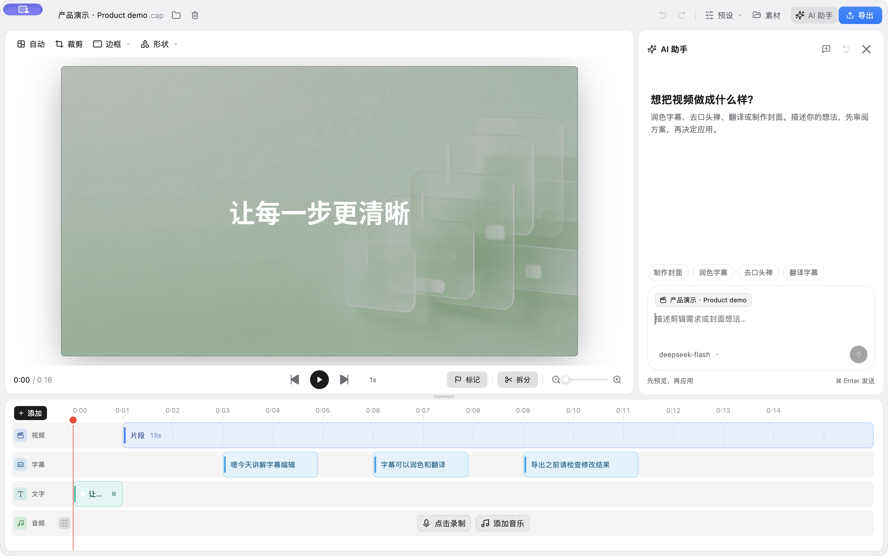

# 灵录 Capwise

**中文** · [English](#english)

把录屏做成一段讲得清楚、看得舒服的视频。
A native Mac studio for screen recordings, captions, and AI-assisted editing.

[下载 macOS 版](https://github.com/joeseesun/capwise/releases/latest) · [报告问题](https://github.com/joeseesun/capwise/issues) · [构建文档](apps/desktop-gpui/README.md) · [许可证](LICENSE)



产品演示、操作教程、课程讲解，不必在录屏、字幕、配音和封面工具之间来回搬运。灵录把这些步骤放在一个本地编辑器里：先录下来，再慢慢打磨。

## 你可以用它做什么

| 能力 | 你得到的结果 |
| --- | --- |
| 屏幕、摄像头与声音录制 | 把操作过程和讲解录进同一个项目 |
| 时间线编辑 | 裁剪、缩放、转场、文字与形状标注，突出观众该看的地方 |
| 字幕工作台 | 在「内容 / 翻译 / 样式」中分别校对文字、审阅译文、调整外观 |
| 双语字幕 | 选择常见语言或自定义目标语言，原文与译文分别设置颜色、描边、阴影与字体 |
| 音乐与配音 | 从音频面板直接添加配乐或录制配音，调整音量与淡入淡出 |
| AI 剪辑助手 | 用一句话提出需求，审阅修改方案后应用，也可以撤销 |
| 助手内制作封面 | 从描述到背景生成、标题和时长设置、预览应用，在同一工作区完成 |
| 模型与 ACP 接入 | 配置自己的模型服务，或连接本机已安装并登录的 ACP 助手 |
| 本地项目与导出 | 保存可继续编辑的项目，再导出成视频或字幕文件 |

## 五分钟开始

1. 从 [GitHub Releases](https://github.com/joeseesun/capwise/releases/latest) 下载 Apple Silicon 版 DMG。
2. 打开 DMG，将 **Capwise** 拖到 **Applications**，再启动「灵录」。
3. 按引导授权屏幕录制；需要录人声或摄像头时，再授予相应权限。
4. 录制一段视频，或导入已有视频。在编辑器中处理字幕、画面和声音。
5. 点击「导出」，选择输出设置和保存位置。

基础录制与编辑不需要注册 Cap 云服务账号。AI 功能可选：请在「设置 → AI 模型」中配置自己的服务。

本次提供 **macOS 13+、Apple Silicon** 安装包。Intel、Windows 和 Linux 暂未提供本项目验证过的发布包。

## AI 助手如何工作

```text
描述目标 → 生成方案 → 查看修改前后 → 应用 → 继续调整 / 撤销
```

可以这样说：

- 「润色这些字幕，保留人名、数字和原意。」
- 「隐藏字幕中的口头禅。」
- 「把字幕翻译成法语，并显示双语。」
- 「把第一条背景音乐调低 6 dB。」
- 「做一个浅绿色的产品演示封面，时长 1 秒。」

助手会先展示方案。对话中的模型选择只影响当前助手会话；你可以搜索模型，也可以进入模型设置管理服务。输入框支持 **⌘ Enter 发送**，运行中可以停止。

封面背景通过你配置的图片服务生成。新封面默认 1 秒，时长可编辑；标题仍然是可修改的文字。

### 配置你的模型

| 设置页 | 用途 |
| --- | --- |
| 字幕识别 | 把音频识别为字幕 |
| 内容生成 | 字幕校对、翻译和编辑助手 |
| 封面生成 | 生成封面背景，支持自定义地址和模型 ID |
| 内容生成 → 本地 AI 助手（ACP） | 检测并连接已安装的助手，读取可用模型 |

需要 API Key 的服务先填写密钥，再获取并选择模型；提供商没有开放模型列表时，可以手动填写模型 ID。火山方舟也支持以 `ep-…` 开头的推理接入点。

ACP 使用本机已有的登录状态。不同适配器的安装、登录和模型支持不同；检测到命令不代表已经登录成功。灵录中的 ACP 编辑助手仅提出可审阅的修改方案，不授予它终端或文件读写权限。

## 数据与费用

- 项目和媒体保存在本机，基础编辑不依赖 Cap 云服务。
- macOS 上的 API Key 保存在登录钥匙串；更新应用不会主动清空密钥。
- 使用云端字幕识别时，音频会发送给所选识别服务。
- 字幕校对、翻译和助手请求会发送相关字幕文字与编辑上下文给你选择的模型。助手不会把整个录屏上传给文本模型。
- 封面生图会发送图片描述给图片服务商。模型服务可能收费，费用与额度由服务商决定。
- 使用本地模型仍可能需要先下载模型文件；ACP 服务是否联网取决于所连接的助手。

## 当前边界

- 助手一次最多读取 80 条字幕；长视频需要分步处理。
- 「去口头禅」目前处理的是字幕文字，不会自动剪掉相应语音。
- AI 可能改错专有名词、语气或翻译，请在应用和导出前审阅。
- 配音质量也取决于麦克风、输入电平和环境；增益调整不能恢复原始录音中缺失的细节。
- 本项目仍在持续迭代。重要项目建议保留原始媒体与备份。

## 开发与验证

灵录基于 [Cap](https://github.com/CapSoftware/Cap)，桌面界面使用 Rust + GPUI，媒体管线使用项目中的录制、渲染和导出 crates。

<details>
<summary>从源码构建</summary>

需要 macOS、Xcode Command Line Tools、Rust、Bun 及项目的原生媒体依赖。桌面应用拥有独立 Cargo workspace。首次准备会下载原生依赖及打过补丁的 GPUI 源码。

```bash
git clone https://github.com/joeseesun/capwise.git
cd capwise
bun install
bun run cap-setup
cd apps/desktop-gpui
cargo build --bin cap-gpui
```

详细说明见 [桌面开发文档](apps/desktop-gpui/README.md)；分发签名、公证和更新包流程见 [发布文档](apps/desktop-gpui/docs/release.md)。开发环境安装不等于已公证的分发包。

</details>

验证重点包括：修改方案的范围校验、字幕时间保留、撤销恢复、模型接入，以及安装包签名。每个版本的实际验证结果与已知限制写在 [Release 说明](https://github.com/joeseesun/capwise/releases) 中。

## 反馈与来源

遇到问题请提交 [Issue](https://github.com/joeseesun/capwise/issues)，附上应用版本、macOS 版本和复现步骤。**请勿上传 API Key 或未经处理的私人录屏。**

- 基于 Cap，保留上游版权与许可；主要代码为 AGPLv3，部分录制与相机 crates 为 MIT，详见 [LICENSE](LICENSE)。
- 助手交互参考 [Qiaomu Agent](https://github.com/joeseesun/Qiaomu-agent)，在原生 GPUI 界面中实现。
- 图标使用项目已有图标与 [Lucide](https://lucide.dev/) 风格资源；字体、媒体与第三方组件遵循各自许可。
- 随附配乐的来源记录见 [音乐说明](apps/desktop-gpui/assets/music/NOTICE.md)。

由 [向阳乔木](https://qiaomu.ai) 维护 · [博客](https://blog.qiaomu.ai) · [乔木推荐](https://tuijian.qiaomu.ai) · [X @vista8](https://x.com/vista8) · [GitHub](https://github.com/joeseesun) · 公众号「向阳乔木推荐看」

---

<a id="english"></a>

## English

**Capwise (灵录)** is a local-first Mac screen recording and editing studio, based on Cap. Record a demo, refine captions, add narration or music, create a cover, and export your video in one workspace.

### Install

Download the Apple Silicon DMG from [Releases](https://github.com/joeseesun/capwise/releases/latest), drag Capwise to Applications, and follow the recording permission guide. This release targets macOS 13+ on Apple Silicon. Intel, Windows, and Linux packages have not been verified for this fork.

Core recording and editing do not require a Cap Cloud account. Optional AI features use your own model providers or installed ACP agents. Configure speech recognition, text generation, and image generation separately in Settings → AI Models.

### Highlights

- Native Rust + GPUI editor with a timeline, zooms, captions, music, narration, and annotations.
- Separate content, translation, and style workspaces; independent original/translated subtitle styling.
- An editing assistant that proposes changes for review before applying them, with undo support.
- In-assistant cover generation, editable titles and cover duration (1 second for a new cover).
- Searchable model selection and local ACP connections.

### Privacy, costs, and limits

Projects remain local. Cloud transcription sends audio to the selected service; AI text features send relevant text and editing context. Cover generation sends the image description. API keys are stored in the macOS login Keychain. Provider charges may apply.

The assistant reads at most 80 captions per request. Filler removal changes subtitle text only, not the recording's speech. Always review AI output. ACP integrations require their own installation and login; the in-app agent does not receive filesystem or terminal permissions.

See the [desktop development guide](apps/desktop-gpui/README.md), [release notes](https://github.com/joeseesun/capwise/releases), and [license](LICENSE). Capwise retains Cap's upstream licensing: primarily AGPLv3, with MIT and third-party exceptions as documented. [Report a bug](https://github.com/joeseesun/capwise/issues) without including credentials or private recordings.
